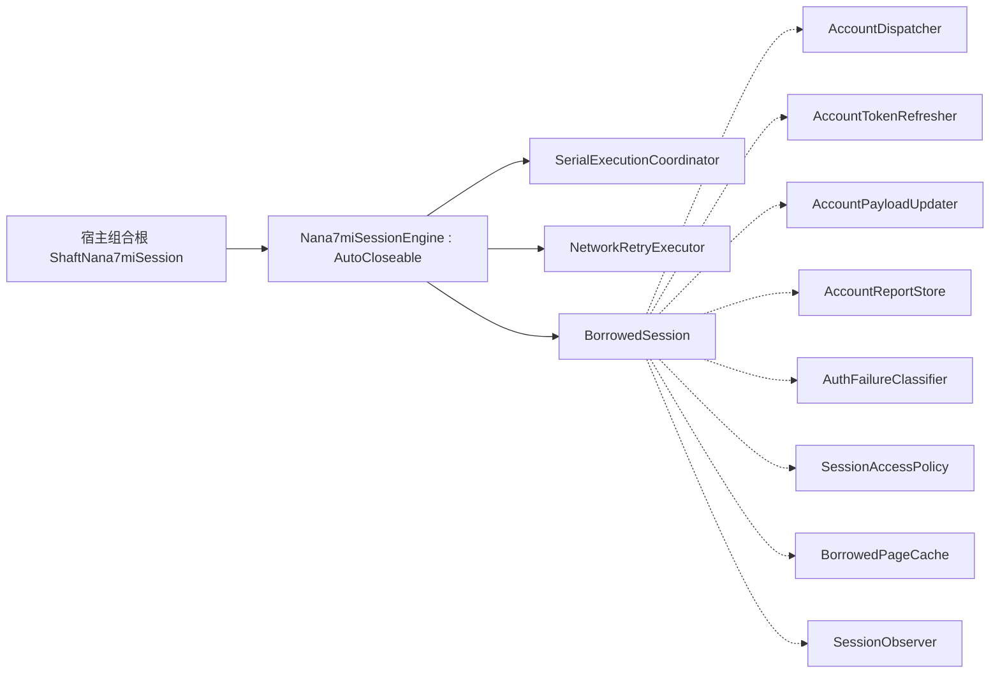

# `:nana7mi` 借号会话框架（Nana7mi Session SDK）

`:nana7mi` 是面向独立发布的纯 Kotlin/JVM 框架库（`java-library` + `org.jetbrains.kotlin.jvm` + `maven-publish` + `explicitApi()`），
负责管理借用账号（Nana7mi）的完整生命周期、令牌轮转持久化、公平串行租约与有界重试。模块**零 Android 依赖**，不引入
OkHttp、Retrofit、Gson、Timber、MMKV、Hilt、`:models` 或任何 Pixiv / PixShaft 业务类型，运行时仅依赖
`kotlinx-coroutines-core`。

对外发布的独立 SDK 文档见 [`nana7mi/README.md`](../nana7mi/README.md)。

## 1. 企业级 API 设计规范

- **二进制演进安全**：所有可扩展的值对象、配置与请求规格（`BorrowedAccount`、`RefreshedTokens`、`RateLimitInfo`、`NetworkRetryPolicy`、`Nana7miSessionConfig`、`FirstPageRequest`、`NextPageRequest`）均采用不可变普通类 + `Builder` / `newBuilder()` + `@Nana7miDsl`，避免公有 `data class` 在未来版本新增字段时破坏已编译消费方的二进制兼容性。
- **零参数爆炸**：首屏与翻页编排通过 `FirstPageRequest` / `NextPageRequest` 参数对象 + Kotlin DSL 承载，接口签名稳定且 Java / Kotlin 双方均可读。
- **零宿主常量泄漏**：刷新原因（`RenewalReason`）、校验失败原因（`ValidationFailureReason`）、缓存操作（`CacheOperation`）、回退原因（`FallbackReason`）全部使用强类型枚举或密封类型；配额桶名称（如 `uid_5h` / `uid_weekly`）留在宿主侧通过 `RateLimitInfo.matchesScope(...)` 判定。
- **显式生命周期与响应式状态**：`Nana7miSessionEngine : AutoCloseable` 支持幂等关闭（关闭后 `newSession()` 抛 `SessionEngineClosedException`，存量会话返回 `AcquireResult.Closed`，在途持久化自然收尾）；`BorrowedSession` 暴露只读 `state` 快照与 `stateFlow: StateFlow<BorrowedSessionState<A>>`，且 `Idle -> CachedCursor` 与 `Lost` 终态转换在运行时原子强校验。
- **凭据防泄漏**：`BorrowedAccount.toString()`、`RefreshedTokens.toString()` 对 token 脱敏；`SessionEvent` 严格只携带元数据；内置参考实现 `InMemoryAccountReportStore` 对吊销的 refresh token 仅存 SHA-256 摘要。
- **发布就绪**：`nana7mi/build.gradle` 内置 `maven-publish`、`sourcesJar`、`javadocJar` 与 `META-INF/proguard/nana7mi-session.pro`。

## 2. 架构与设计模式

| 关注点 | 采用模式 | 核心类型 |
|---|---|---|
| 依赖隔离 | Hexagonal Ports & Adapters (DIP) | `AccountDispatcher`, `AccountTokenRefresher`, `AccountPayloadUpdater`, `AccountReportStore`, `AuthFailureClassifier`, `SessionAccessPolicy`, `SessionClock`, `RequestIdGenerator`, `BorrowedPageCache` |
| 会话生命周期 | 显式有限状态机 (State Pattern) | `BorrowedSessionState` (`Idle` / `CachedCursor` / `Active` / `Lost`) + `StateFlow` |
| 进程内串行协调 | Lease / Resource Guard | `SerialExecutionCoordinator`, `ExecutionLease.guarded` |
| 有界网络重试 | Strategy / Policy | `NetworkRetryPolicy`, `TransportFailureClassifier`, `NetworkRetryExecutor` |
| 整页流程编排 | Parameter Object + Template Method + Around-Advice | `FirstPageRequest`, `NextPageRequest`, `FirstPageHooks`, `NextPageHooks` |
| 引擎组装与隔离 | Factory + Fluent Builder (`@Nana7miDsl`) | `Nana7miSessionEngine`, `Nana7miSessionConfig`, `InMemoryAccountReportStore` |
| 诊断与配额通道 | Observer + Composite（异常隔离） | `SessionObserver`, `SessionObserver.composite`, `SessionEvent` |
| 会员归属合并 | Domain Policy（单源真相） | `MembershipPolicy.attribute`, `MembershipPolicy.merge` |

## 3. 宿主接入（`:app`）

- 纯 JVM SDK 内核：`nana7mi/src/main/kotlin/ceui/pixiv/nana7mi/session/`
- 宿主适配器：`app/src/main/java/ceui/pixiv/nana7mi/host/ShaftNana7miAdapters.kt`
- 进程级组合根：`app/src/main/java/ceui/pixiv/nana7mi/host/ShaftNana7miSession.kt`（`@Singleton`，经 `ServicesProvider.nana7miSession` 注入）
- 消费方：`SearchIllustRepo` 与 `SearchNovelRepo` 通过 Kotlin DSL 复用 `executeFirstPage` / `executeNextPage`；`SessionManager.freshPremiumOf` 与借号刷新共用 `MembershipPolicy.attribute`；`NetworkFailureClassifier` 与 `Nana7miNetworkRetry` 复用 `:nana7mi` 的 `TransportFailureClassifier` 与 `NetworkRetryExecutor`。
