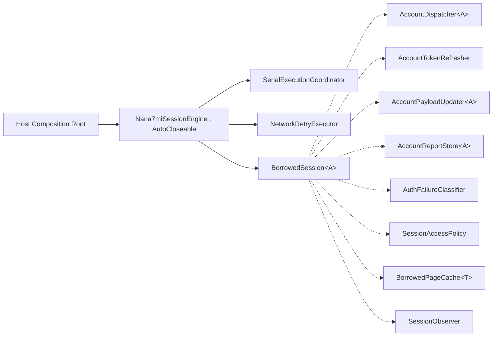
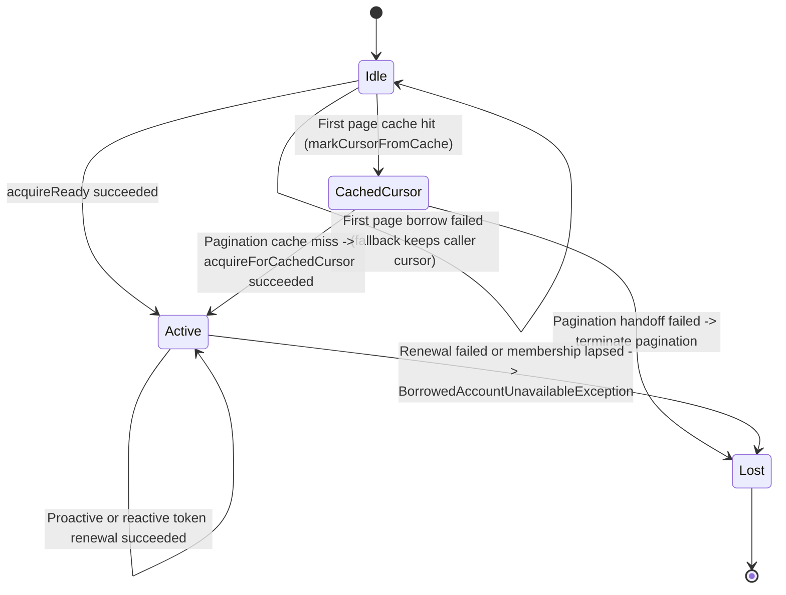

# Nana7mi Session SDK (`:nana7mi`)

A pure-JVM, zero-Android-dependency Kotlin framework library for managing borrowed-account session lifecycles: account dispatch, proactive & reactive OAuth token rotation, durable outbox handoff, cancellation-safe FIFO serial leasing, bounded-budget transport retries, cached-cursor handoff, and structured observability.

Designed for publishing as an independent artifact (`com.github.SoxiaLiSA:nana7mi-session`) with **binary-compatibility discipline**, **strict Kotlin `explicitApi()`**, **first-class Kotlin DSL & Java Builder interoperability**, and a **single runtime dependency** (`kotlinx-coroutines-core`).

---

## Features & Guarantees

- **Zero Android / HTTP / JSON / Logging Lock-In**: Pure `java-library` + `org.jetbrains.kotlin.jvm` (JDK 17). No Android SDK, OkHttp, Retrofit, Gson, Timber, MMKV, Hilt, or domain DTOs.
- **Hexagonal Architecture (Ports & Adapters)**: Host applications plug in concrete adapters for dispatch, OAuth refresh, payload projection, durable reporting, auth-failure classification, caching, and diagnostics.
- **Explicit Finite State Machine (`BorrowedSessionState`)**:
  - `Idle` → `CachedCursor` / `Active` → `Lost` (strictly terminal).
  - Illegal flag combinations are unrepresentable at compile time and rejected atomically at runtime via `StateFlow`.
  - Once `Lost`, pagination terminates safely and never falls back to a caller's own non-privileged credentials.
- **Token Rotation Durability**: After OAuth rotates a refresh token, `AccountReportStore.persistOnline` runs inside `NonCancellable` **before** any cancellable delivery attempt. If durable persistence fails, the session refuses to return `Success`.
- **Cancellation-Safe Fair Serial Leasing (`SerialExecutionCoordinator` / `ExecutionLease`)**:
  - FIFO `Semaphore(1)` permit prevents overlapping borrowed flows across concurrent callers.
  - Reference-counted `ExecutionLease.guarded` holds the permit until blocking OAuth calls and `NonCancellable` persistence have actually exited—even if the outer coroutine is cancelled.
- **Bounded-Budget Transport Retry (`NetworkRetryExecutor`)**:
  - Measures total budget from attempt #1 start on a monotonic clock; skips retries when remaining window is too small.
  - Distinguishes internal retry deadline (preserves original transport error) from external coroutine cancellation (propagates `CancellationException`).
  - Never replays non-idempotent (`requestId == null`) dispatches or non-retryable TLS errors.
- **Tri-State Membership Attribution (`MembershipPolicy`)**:
  - Accepts membership updates only when `reportedUid == expectedUid && expectedUid > 0`.
  - Preserves stored membership when the OAuth provider omits it (`null`); only an explicit `false` demotes and reports back for pool reclassification.
- **Credential Safety**: `BorrowedAccount.toString()`, `RefreshedTokens.toString()`, and `SessionEvent` never expose raw `accessToken` or `refreshToken` strings. `InMemoryAccountReportStore` stores quarantined refresh tokens only as SHA-256 hex digests.
- **Binary Compatibility**: Public value/config/request types use immutable non-`data` classes with `Builder` / `newBuilder()` and `@Nana7miDsl`, allowing additive evolution without breaking compiled callers.

---

## Architecture



### Session Finite State Machine



---

## Installation

### Gradle (JitPack / Maven)

```kotlin
dependencies {
    implementation("com.github.SoxiaLiSA:nana7mi-session:1.0.0")
}
```

### Gradle (Multi-Module Local Project)

```groovy
implementation project(path: ':nana7mi')
```

---

## Quick Start (Kotlin DSL)

```kotlin
import ceui.pixiv.nana7mi.session.*

// 1. Construct one process-scoped (or DI @Singleton) engine at your composition root:
val engine = Nana7miSessionEngine.create<MyAccountDto> {
    dispatcher = AccountDispatcher { requesterUid, requestId ->
        myBackend.dispatchBorrowedAccount(requesterUid, requestId)
    }
    tokenRefresher = AccountTokenRefresher { uid, refreshToken ->
        myOAuthClient.refresh(uid, refreshToken)
    }
    payloadUpdater = AccountPayloadUpdater { previous, tokens, attributedPremium ->
        previous.copy(
            accessToken = tokens.accessToken,
            refreshToken = tokens.refreshToken,
            isPremium = MembershipPolicy.merge(previous.isPremium, attributedPremium),
        )
    }
    reportStore = InMemoryAccountReportStore() // or your durable MMKV/Room outbox
    authFailureClassifier = AuthFailureClassifier { error -> isUpstreamOAuthExpired(error) }
    observer = SessionObserver.composite(myLoggerObserver, myQuotaObserver)
}

// 2. Spawn one isolated session per search / cursor generation:
val session = engine.newSession()

val firstPage = session.executeFirstPage {
    requesterUid = currentUserId
    idempotencyEnabled = true
    cache = myFirstPageCache
    fallback { reason -> fetchPreviewPage(reason.code) }
    request { account -> api.search(account.authorizationHeader(), query) }
}

// 3. Paginate safely with the same session:
val secondPage = session.executeNextPage {
    requesterUid = currentUserId
    idempotencyEnabled = true
    cache = myNextPageCache
    directRequest { api.nextPageWithOwnSession(nextUrl) }
    endPagination { reason -> Page.emptyTerminal() }
    request { account -> api.nextPage(account.authorizationHeader(), nextUrl) }
}

// 4. Close cleanly when the owning scope shuts down (or keep for process lifetime):
engine.close()
```

---

## Java Interoperability

All value objects, configurations, policies, request specifications, and builders expose clean `@JvmStatic` / `@JvmField` / fluent `Builder` APIs:

```java
NetworkRetryPolicy retryPolicy = NetworkRetryPolicy.builder()
    .totalBudgetMs(10_000L)
    .retryDelayMs(200L)
    .maxRetries(1)
    .build();

InMemoryAccountReportStore<MyAccount> store = new InMemoryAccountReportStore<>();

Boolean membership = MembershipPolicy.attribute(102L, 102L, true);
```

---

## Testing

The SDK has zero global mutable singletons and accepts deterministic `SessionClock`, `RequestIdGenerator`, `SessionAccessPolicy`, `InMemoryAccountReportStore`, and `SessionObserver` fakes, so every timeout, 55-minute expiry, 409 conflict replay, `NonCancellable` persistence race, and serial permit cancellation case runs deterministically in milliseconds on pure JVM:

```bash
./gradlew :nana7mi:test
```

## Publishing

```bash
./gradlew :nana7mi:publishToMavenLocal
```
